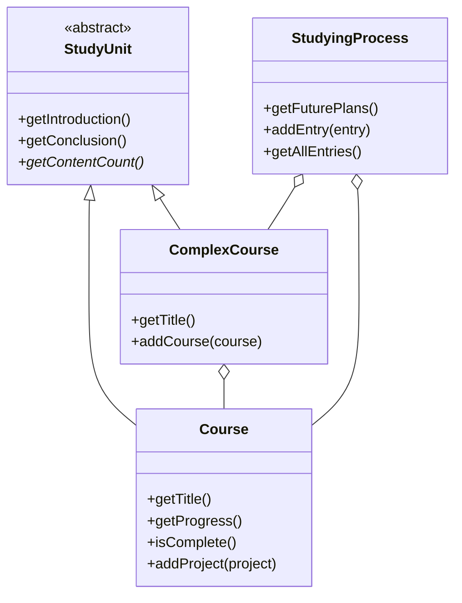

# IvKoff Portfolio — Ivan Kovalov

**Full-Stack Developer (career changer)** · React · Next.js · TypeScript · Node.js


> Six years on the line at large meat-processing plants → 1.5 years of intensive study
> (Mate Academy plus additional courses) → 8 shipped projects, including a real-time chat app
> and a Stripe checkout.

This repository is my personal portfolio site. It is deliberately built as a **hands-on demonstration
of Object-Oriented Programming and Test-Driven Development**, not just a page with links: the projects,
courses and skills shown on the site are modelled as TypeScript classes and covered by unit tests.

**Live Demo:** https://ivkoff-react-portfolio.netlify.app/

---

## For recruiters — the short version

| | |
|---|---|
| **Role** | Junior / entry-level Full-Stack Developer (React, Next.js, Node.js) |
| **Location** | Poland (Poznań area) — open to remote work |
| **Experience** | No commercial experience yet — and I say so openly. What I do have are 8 finished, deployed projects that get progressively more ambitious. |
| **Background** | 6 years as a professional butcher in large meat-processing plants: precision, patience and staying calm when things go wrong. |
| **Languages** | English, Polish (this site is also available in Ukrainian) |
| **Contact** | [kovalevivan420@gmail.com](mailto:kovalevivan420@gmail.com) · [LinkedIn](https://www.linkedin.com/in/ivan-kovalov-197759348) · [GitHub](https://github.com/IvanKovalyoff) |

**If you only have two minutes**, look at:

1. [`src/models/game/Game.ts`](src/models/game/Game.ts) and its [tests](src/models/game/Game.test.ts) — a small state machine written test-first, with injectable randomness and explicit timestamps so it is fully deterministic.
2. [`src/models/studyingProcess/`](src/models/studyingProcess) — a class hierarchy (`StudyUnit` → `Course` / `ComplexCourse` → `StudyingProcess`) that holds all the content of the *Projects* section.
3. [The Chat App](https://github.com/IvanKovalyoff/chat-app) — my most ambitious project: TypeScript, React, Node.js, Express, Socket.IO, PostgreSQL and Prisma.

---

## What this project demonstrates

- **OOP in practice** — abstract base class, inheritance, encapsulation (private fields + getters) and composition, used for real content rather than toy examples.
- **TDD** — 89 unit and component tests in 12 suites (domain models, the game state machine, React components, content data and locale files). The game logic was written test-first.
- **Internationalisation** — three languages (English, Polish, Ukrainian) with `react-i18next`, browser-language detection, the choice persisted in `localStorage`, and `<html lang>` kept in sync. A test guarantees that every translation key exists in every language and keeps the same `{{placeholders}}`.
- **Modern React** — React 19, function components and hooks, Zustand for shared state, strict TypeScript, ESLint (with React Hooks rules) and Prettier, checked by CI on every push.
- **Theming** — six complete themes (colours, fonts, gradients, hero photo, hero layout and logo) driven by a single `data-theme` attribute plus per-section style maps.
- **Responsive UI** — mobile-first Tailwind CSS 4 layout, a mobile navigation menu with a labelled toggle, labelled icon links and translated alt texts.
- **Performance and accessibility** — Lighthouse on the production build (measured locally with gzip and Netlify-style caching): accessibility, best-practices and SEO all 100, desktop performance 100 and mobile roughly 85 on simulated slow 4G. First load is about 0.5 MB: images are resized and served as WebP, fonts are self-hosted, project screenshots load lazily, and there is a skip link and a `<main>` landmark.
- **Production setup** — GitHub Actions (lint, formatting, build, unit tests and the Playwright suite), Dependabot, a `netlify.toml` with long-lived caching for hashed assets and security headers including a Content-Security-Policy, and per-language `<title>` / description plus Open Graph tags for link previews.
- **Layout that cannot collide** — the Hero uses one shared CSS-grid layout with container-query units and fluid type instead of per-screen absolute offsets, so text never lands on the photo whatever the window size. A Playwright suite checks it across 27 screen sizes × 6 themes × 3 languages (see [Hero layout](#hero-layout)).

## Features

- **Hero, About me, Skills, Projects, Contacts** sections with a sticky header and smooth-scroll navigation.
- **Featured projects** first (Chat App, IvKoff Store, Expenny), then the full learning path below it.
- **Skills** — 49 technologies in 9 categories, all defined as data and rendered from `Skills` / `Category` models.
- **Projects grouped by learning path** — each course shows its progress and the projects built during it, including an honest "first attempt vs. finished version" story for the Chat App.
- **Language switcher** with flags (EN / PL / UA).
- **Theme mini-game** — see below.

### The theme mini-game

Press **"Play a game?"** in the *About me* section:

1. a 5-second countdown starts;
2. a random theme is previewed live on the whole page for 10 seconds — **apply** it or **reset** to the default;
3. if you do nothing, the next theme is previewed (no repeats);
4. once every theme has been shown without a decision, the button is disabled for a 5-minute cooldown.

`Game` is a pure state machine (`idle → countdown → showingTheme → cooldown`) with no timers and no clock inside it. The React layer (a Zustand store) owns the real timers and passes timestamps in, which is what makes the class trivial to unit test.

## Featured projects

These are the projects presented on the site (grouped there by the course during which they were built):

| Project | What it is | Stack | Links |
|---|---|---|---|
| **Chat App** | Full-stack real-time chat: JWT + Google OAuth, persistent history, live typing indicators | TypeScript, React, Node.js, Express, Socket.IO, PostgreSQL, Prisma | [Live](https://chat-for-everyone-app.netlify.app) · [Code](https://github.com/IvanKovalyoff/chat-app) |
| **Expenny** | Subscription tracker | Next.js, Firebase, GSAP | [Live](https://expenny-tracker.netlify.app) · [Code](https://github.com/IvanKovalyoff/expenny) |
| **IvKoff Store** | E-commerce app with Stripe checkout and e-mail via Resend | Next.js, Stripe, Resend | [Live](https://ivkoff-store.netlify.app) · [Code](https://github.com/IvanKovalyoff/IvKoff_Store) |
| **Brogram** | Gym / training tracker built with the frontend only | React, Vite | [Live](https://brogram-training.netlify.app) · [Code](https://github.com/IvanKovalyoff/Brogram) |
| **TW:MF Music Festival** | Responsive single-page site: semantic HTML, ARIA, dark mode that persists | Tailwind CSS 4, HTML, JavaScript | [Live](https://ivankovalyoff.github.io/Learning-Tailwind-CSS/) · [Code](https://github.com/IvanKovalyoff/Learning-Tailwind-CSS) |
| **Gadget Store** | SPA product catalogue with dedicated product pages, focused on architecture and code quality | React, TypeScript, SCSS, React Router, Storybook | [Live](https://ivankovalyoff.github.io/Gadget-store/) · [Code](https://github.com/IvanKovalyoff/Gadget-store) |
| **Game 2048** | Web version of 2048 | JavaScript, HTML, CSS | [Live](https://IvanKovalyoff.github.io/Game-2048/) · [Code](https://github.com/IvanKovalyoff/Game-2048) |
| **Landing Page** | Responsive product landing page (futuristic wireless speaker) | HTML, SCSS, JavaScript | [Live](https://IvanKovalyoff.github.io/Landing-page/) · [Code](https://github.com/IvanKovalyoff/Landing-page) |

## Tech stack

| Area | Tools |
|---|---|
| Language | TypeScript (strict), modern JavaScript (ES2023) |
| UI | React 19, Tailwind CSS 4, Font Awesome, `flag-icons` (three SVG flags), self-hosted Fontsource fonts |
| State | Zustand |
| i18n | `i18next`, `react-i18next`, `i18next-browser-languagedetector` |
| Build | Vite 8, pnpm |
| Testing | Jest 30, ts-jest, React Testing Library, jest-dom; Playwright for the Hero layout |
| Code quality | ESLint 10 (typescript-eslint, react-hooks, react-refresh), Prettier (run through ESLint and `pnpm format:check`), GitHub Actions CI, Dependabot |
| Deploy | Netlify (`netlify.toml`), pnpm |

## Architecture

```text
src/
├── components/     # Header, Hero, AboutMe, MySkills, MyProjects (+ cards), MyContacts, Footer,
│                   # GameWidget, LanguageSwitcher — each with its own theme style map
│   └── Hero/       # shared grid layout (hero.css) + per-theme art direction (heroCompositions.ts)
├── data/           # content as data: skills, studying process (courses & projects), contacts, themes
├── models/         # framework-free domain model, unit-tested
│   ├── game/             # Game state machine
│   ├── skills/           # Skills → Category → Skill
│   └── studyingProcess/  # StudyUnit → Course / ComplexCourse → StudyingProcess
├── store/          # Zustand store: owns the timers that drive the Game model
├── i18n/           # i18next setup (also keeps <html lang>, <title> and the description in sync)
└── locales/        # en.json, pl.json, uk.json (+ a test that keeps them in sync)

.github/            # CI workflow and Dependabot config
netlify.toml        # build, caching and security headers
design-sources/     # original full-size artwork, kept locally (git-ignored)
```



## Getting started

**Prerequisites:** Node.js 20.19+ (or 22.12+) and [pnpm](https://pnpm.io/).

```bash
git clone https://github.com/IvanKovalyoff/react-portfolio.git
cd react-portfolio
pnpm install
pnpm dev        # http://localhost:5173
```

| Script | What it does |
|---|---|
| `pnpm dev` | Start the Vite dev server |
| `pnpm build` | Type-check (`tsc -b`) and create a production build in `dist/` |
| `pnpm preview` | Serve the production build locally |
| `pnpm test` | Run the Jest test suites |
| `pnpm test:e2e` | Run the Playwright Hero-layout suite (first time: `pnpm exec playwright install chromium`) |
| `pnpm lint` | Run ESLint (includes Prettier) |
| `pnpm format` / `pnpm format:check` | Format the code with Prettier / only check it |

## Testing

```bash
pnpm test
```

- `Game` — state transitions, countdown, theme cycling without repeats, cooldown, `apply` / `reset` (random function and clock are injected).
- `Skills`, `Category` — adding, de-duplicating and removing items.
- Components — `GameWidget` (countdown, apply, reset), `ProjectCard` (links, compact variant, lazy screenshot) and the hero composition data.
- Content data — every project has translations, valid URLs and, for the featured ones, a summary.
- `StudyUnit`, `Course`, `ComplexCourse`, `StudyingProcess` — inheritance contract, progress, content counts.
- Locales — identical keys and interpolation placeholders across English, Polish and Ukrainian.

### Hero layout

The Hero mixes a large photo with text, and the classic way to break that is positioning both at fixed offsets: on some screen heights the two collide. Here the layout is built so that they cannot:

- **One layout, six looks.** `hero.css` is a single CSS grid. The stage is a size container, so everything is measured in `cqw`/`cqh` (the space the Hero actually gets) rather than in window breakpoints. Landscape stages get a photo column plus a text column, portrait stages a single column of rows.
- **Photo and text never share a cell.** Type is fluid (`clamp()`, capped by the stage height) and the photo is sized from what is left, so on a short screen both shrink together instead of overlapping.
- **Art direction is data.** `heroCompositions.ts` says which side the photo is on, how the socials are placed and how the portrait layout is ordered for each theme; `heroFaceZones.ts` records a "keep-out" rectangle around the face in each (trimmed) photo.
- **It is tested, not eyeballed.** `e2e/hero-layout.spec.ts` loads the built app at 27 viewports (small phones to 2560 px desktops, portrait and landscape), switches through all six themes in English, Polish and Ukrainian, and fails if any text or the socials leave the Hero, overlap each other, touch the photo or cover the face, or if the type or photo become too small. The build used by the tests is made with `vite build --mode e2e`, which only exposes the game store on `window`; normal builds are unaffected.

## Deployment

The site is a static Vite build, so any static host works. On Netlify:

1. Import the repository; `netlify.toml` already sets `pnpm build` and the `dist` folder.
2. Netlify provides the site address to the build (`URL`); `vite.config.ts` uses it, or `SITE_URL` if you set that yourself, to add the canonical link and the Open Graph / Twitter image tags. Local builds skip them.
3. `netlify.toml` also sends the security headers. The Content-Security-Policy only allows the site's own files plus the Google Maps iframe in *Contacts*: if you add another third-party script, font or image host, add it there.

Image sources: the full-size originals live in `design-sources/` (git-ignored); the copies in `src/assets` are already resized (icons 128 px, screenshots 1200 px wide, WebP). Put new artwork through the same steps before adding it.

## What's next

- Finish the *React + Next.js — Advanced Web Development in Practice* course and add the resulting project.
- Deepen backend skills with NestJS, then practise testing with Jest, Testing Library and Cypress.
- Return to Mate Academy for the Vue.js and Angular modules.

## Contact

I'm looking for the team that gives me my first professional opportunity in software development.
I learn fast, I finish what I start, and I'd rather show you the code than tell you about it.

- E-mail: [kovalevivan420@gmail.com](mailto:kovalevivan420@gmail.com)
- LinkedIn: [linkedin.com/in/ivan-kovalov-197759348](https://www.linkedin.com/in/ivan-kovalov-197759348)
- GitHub: [github.com/IvanKovalyoff](https://github.com/IvanKovalyoff)
